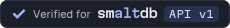

# Plugin badges

Three badges say how a plugin relates to smaltdb. They share the "Powered by" pill's size and type, and each tier drops one brand element.

| Light | Dark | Tier | Who grants it |
| --- | --- | --- | --- |
|  |  | **Official:** made and maintained by smaltworks | smaltworks |
|  |  | **Verified:** passes the smaltworks compatibility tests for plugin API version 1 | smaltworks, after the tests pass |
|  |  | **Works with:** the author says it works; smaltworks hasn't checked | The plugin's author |

## Which badge you may use

- **Official** is only for packages in the `@smaltdb` npm scope, which only smaltworks can publish to.
- **Verified** is only for plugins listed as verified on smaltdb.dev/plugins, for the API version on the badge. Link the badge to that entry. Verified means the compatibility tests pass; it is not a security review.
- **Works with** is open to any plugin author. Link it to your own project page.

Name a third-party plugin `<product>-plugin-<name>`, for example `smaltdb-plugin-geo`. The `@smaltdb` scope and names that start with `smalt` are reserved for smaltworks.

## Snippet

```html
<a href="https://smaltdb.dev/plugins">
  <picture>
    <source media="(prefers-color-scheme: dark)" srcset="https://raw.githubusercontent.com/stenhoor/smalt-brand/main/badges/plugins/works-with-smaltdb-on-dark.svg">
    
  </picture>
</a>
```

Change the file names and alt text for another tier. The badges vary in width, so set only the height.

Regenerate with `python3 scripts/plugin_badges.py <Geist[wght].ttf> <MartianMono[wdth,wght].ttf>`. Only smaltdb has a plugin API today; when another product gets one, add it to `PRODUCTS` in the script.
